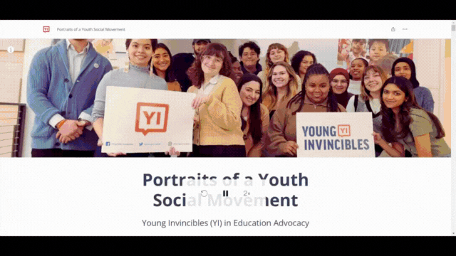

  <h1>📢 Portraits of a Youth Social Movement: Young Invincibles (YI) in Education Advocacy</h1>

  

    A StoryMaps presentation examining youth advocacy
    and equitable access to higher education.
  

<h2>📑 Table of Contents</h2>

<ul>
  <li><a href="#objective">Objective</a></li>
  <li><a href="#project-details">Project Details</a></li>
  <li><a href="#storymaps">StoryMaps</a></li>
  <li><a href="#images">Images</a></li>
</ul>

<h2>🎯 Objective</h2>

  This project focuses on the work of Young Invincibles (YI),
  a youth advocacy organization in the United States,
  and their role in promoting equitable access to higher
  education. Through their leadership model, campaigns,
  research, and policy efforts, YI strengthens the voices
  of young people and addresses educational inequities.
  This work empowers young people to engage in
  education advocacy.

<h2>🛠️ Project Details</h2>

  <strong>Tools:</strong> ArcGIS Online, ArcGIS StoryMaps

<h2>🌐 StoryMaps</h2>

  <a href="https://arcg.is/v1uu4">
    View StoryMaps
  </a>

<h2>🖼️ Images</h2>

<h3>Portraits of a Youth Social Movement StoryMaps</h3>

<table>
  <tr>
    <td>
      
    </td>
  </tr>
</table>

  

    <a href="https://github.com/redefiningvicky/Technical-Projects">
      Back to Technical Projects
    </a>
    &nbsp; • &nbsp;
    <a href="https://github.com/redefiningvicky/redefiningvicky">
      Back to Portfolio
    </a>
  

